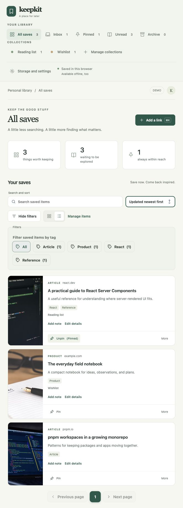
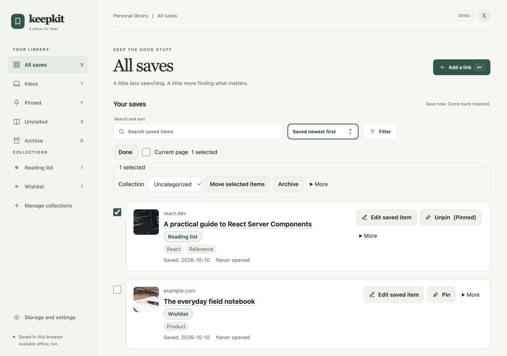
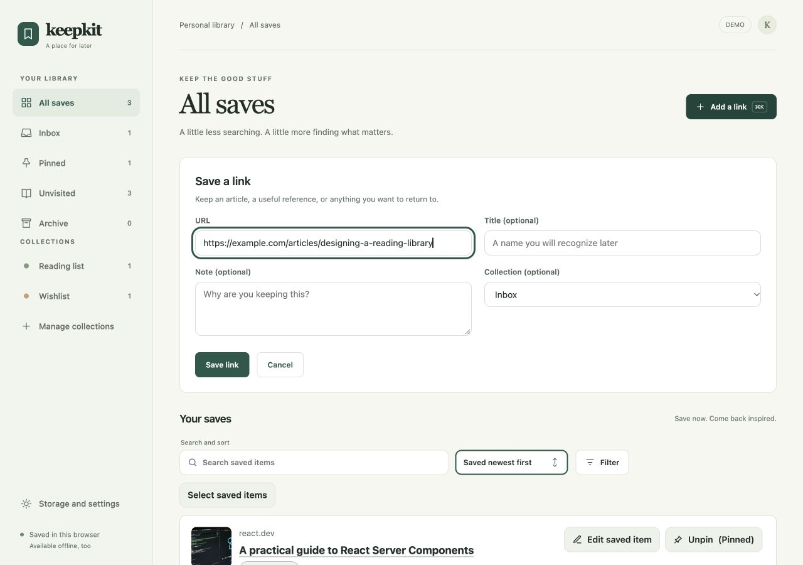
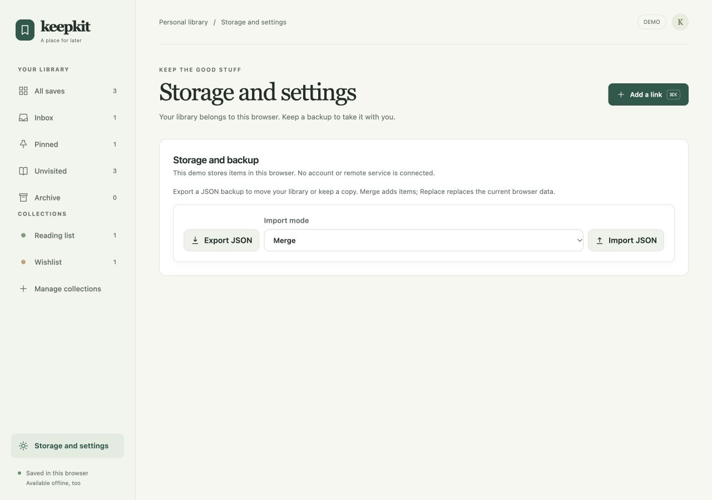

# KeepKit

[日本語](#日本語) | [English](#english)

Release: v0.28.11

## 日本語

KeepKitは、Reactアプリに保存・コレクション機能を追加する、非同期・ローカルファーストのツールキットです。

### できること

- 保存ボタンと、検索・ソート・ページング付きの一覧
- タグ・メモ・コレクション・ピン留め・アーカイブによる整理
- Inbox、保存した検索条件、閲覧記録を使った再発見
- ブラウザー内の永続化、JSONバックアップ、独自サーバーとの同期

### デモアプリ

`apps/demo`の実画面です。サンプルを保存し、タグ・コレクション・ピン留めを設定しています。
初期画面は「すべての保存」です。記事のタイトルから再訪し、検索・タグ・コレクションや、同じ行での選択操作で整理できます。
未訪問は「まだ開いていないリンク」を表し、読了状態ではありません。





<details>
<summary>リンク保存・バックアップの画面を見る</summary>

URLだけでリンクを保存できます。タイトル・メモ・保存先コレクションは任意です。タイトル未入力の新規リンクはドメイン名で表示し、同じURLの再保存では既存タイトルと未変更の整理情報を保持します。
編集は自動保存され、「完了」でも保存成功を待って閉じます。保存後は「すべての保存」で対象を表示します。アーカイブ済みリンクの再保存は状態を維持し、アーカイブで対象を表示します。



データはブラウザー内に保存されます。JSONでバックアップを出力し、Merge（結合）／Replace（置換）で読み込めます。



</details>

### はじめる

React 18以降を使うアプリにインストールします。

```bash
pnpm add @keepkit/ui
```

```tsx
import "@keepkit/ui/theme.css";
import { createBrowserStorageAdapter, createKeepKit } from "@keepkit/ui";

type ArticleMeta = { title: string; url: string };
const keep = createKeepKit<ArticleMeta>({
  storage: createBrowserStorageAdapter({ key: "my-app:items" }),
  locale: "ja",
});

export function App() {
  return (
    <keep.Provider>
      <keep.Button
        item={{
          id: "article-123",
          targetType: "article",
          meta: { title: "Example article", url: "/articles/123" },
        }}
      />
      <keep.Collection
        query={{ targetType: "article", sort: { by: "savedAt", direction: "desc" } }}
        layout="list"
        bulkActionsVariant="inline"
        features={{ bulkActions: true, pin: true, archive: true }}
        itemCardProps={{ presentation: "reading", href: (item) => item.meta.url, trackOpen: true }}
      />
    </keep.Provider>
  );
}
```

`createKeepKit<TMeta>()`で、保存するメタデータの型をProvider・コンポーネント・hooksで共有できます。
一覧は検索・ソート・ページングと、読み込み中・空・エラーの表示を備えています。

### パッケージと使い分け

| パッケージ | 用途 |
| --- | --- |
| [@keepkit/ui](./packages/keepkit-ui/README.md) | React向けUI。標準テーマ、Tailwind対応、独自レイアウトへの組み込み |
| [@keepkit/core](./packages/keepkit/README.md) | フレームワーク中立の処理、React hooks、ストレージ・同期・バックアップ |

`createBrowserStorageAdapter`はIndexedDBを優先し、使えない場合はlocalStorageに切り替えます。
fallbackで受け付けた変更は永続journalに記録し、IndexedDB復旧後に削除も含めて自動反映します。障害中は最後に永続化できた完全スナップショットと保留操作を表示します。予備データが古い場合は`storage.recovery.getState()`で確認できます。障害時の書き込み・復旧にはWeb Locks API、または独自journalの排他実装が必要です。
既存の分岐データは`KeepFallbackRecovery`で比較し、競合を選択して復元できます。導入時は旧実装のタブをすべて更新してください。復旧手順と残る制約は[Coreガイド](./packages/keepkit/README.md)を参照してください。
端末間の同期には`SyncStorageAdapter`とアプリ側の`RemoteSyncDriver`が必要です。
認証とサーバーAPIはアプリ側で実装します。

保存成功後のコールバック・プラグイン通知の例外は`onError`の`phase: "notification"`で報告します。保存済みデータは維持し、保存操作は成功として完了します。
`Collection`の`reorderable`は手動順序を既定にし、表示中の項目だけを並べ替えます。日時ソートとの切替、Undo、カードリンクの構成は[UIガイド](./packages/keepkit-ui/README.md)を参照してください。

JSONバックアップは保存アイテム・コレクション定義・所属を含みます。閲覧履歴・鑑賞記録・進行位置は含みません。
Replace（置換）は対象範囲の既存データを置き換え、失敗時のロールバックはありません。

### サンプル

- [リンクライブラリ](./apps/demo): 保存・整理・検索・バックアップ
- [コレクション画面](./apps/collection-demo): Workspaceや表示レイアウトの組み合わせ
- [Next.js App Router](./examples/next-app-router): Server Componentとクライアント境界
- [Next.js Pages Router](./examples/next-pages-router): SSR・認証付きAPIとの接続
- [認証付き同期](./examples/authenticated-sync): トークン取得・オフラインキュー・ユーザー切り替え

### 開発

Node.js 22.22.2以降、pnpm 11.24.0を使用します。

```bash
pnpm install --frozen-lockfile
pnpm dev
```

デモだけを起動する場合は`pnpm --filter @keepkit/demo dev`を使います。
検証はビルド後に実行します。

```bash
pnpm build
pnpm typecheck
pnpm check
pnpm test
pnpm package:check
pnpm exec playwright install chromium firefox webkit
pnpm typecheck:browser
pnpm test:browser
```

変更履歴は[RELEASE_NOTES.md](./RELEASE_NOTES.md)を参照してください。

## English

KeepKit is an async, local-first toolkit for adding save and collection features to React apps.

### Features

- Save buttons and searchable, sortable, paginated lists
- Tags, notes, collections, pinning, and archiving
- Inbox, Saved Views, and rediscovery through activity tracking
- Browser persistence, JSON backups, and integration with your own sync server

### Demo app

These are actual screens from `apps/demo`, with sample items saved, tagged, assigned to collections, and pinned.
The initial view is All saves. Revisit links through their titles, then organize them with search, tags, collections, and selection on the same rows. Unvisited means never opened, not unread.


<details>
<summary>View the link-saving and backup screens</summary>

Save with just a URL. Title, note, and collection are optional. A new untitled link uses its domain; resaving the same URL keeps its existing title and untouched organization. Edits autosave, and Done waits for saving to succeed before closing. Saving reveals the item in All saves; resaving an archived link preserves its state and reveals it in Archive.


Data stays in the browser. Export a JSON backup and import it using Merge or Replace mode.


</details>

### Getting started

Install in an app using React 18 or later.

```bash
pnpm add @keepkit/ui
```

```tsx
import "@keepkit/ui/theme.css";
import { createBrowserStorageAdapter, createKeepKit } from "@keepkit/ui";

type ArticleMeta = { title: string; url: string };
const keep = createKeepKit<ArticleMeta>({
  storage: createBrowserStorageAdapter({ key: "my-app:items" }),
  locale: "en",
});

export function App() {
  return (
    <keep.Provider>
      <keep.Button
        item={{
          id: "article-123",
          targetType: "article",
          meta: { title: "Example article", url: "/articles/123" },
        }}
      />
      <keep.Collection
        query={{ targetType: "article", sort: { by: "savedAt", direction: "desc" } }}
        layout="list"
        bulkActionsVariant="inline"
        features={{ bulkActions: true, pin: true, archive: true }}
        itemCardProps={{ presentation: "reading", href: (item) => item.meta.url, trackOpen: true }}
      />
    </keep.Provider>
  );
}
```

`createKeepKit<TMeta>()` shares your metadata type across the provider, components, and hooks.
The collection includes search, sorting, pagination, and loading, empty, and error states.

### Packages

| Package | Purpose |
| --- | --- |
| [@keepkit/ui](./packages/keepkit-ui/README.md) | React UI with an optional theme, Tailwind support, and custom layouts |
| [@keepkit/core](./packages/keepkit/README.md) | Framework-neutral logic, React hooks, storage, sync, and backups |

`createBrowserStorageAdapter` prefers IndexedDB and falls back to localStorage.
Changes accepted in fallback storage enter a durable journal and replay automatically, including deletions, after IndexedDB recovers. During an outage, reads use the last durable complete snapshot plus pending operations. Inspect `storage.recovery.getState()` for stale reserve data. Fallback writes and recovery require Web Locks or a custom journal with safe exclusive access.
Use `KeepFallbackRecovery` to compare existing branches and select conflicting records for restoration. Refresh all tabs running the older implementation when adopting this journal. See the [Core guide](./packages/keepkit/README.md) for recovery steps and limits.
Cross-device sync requires `SyncStorageAdapter` and an application-provided `RemoteSyncDriver`.
Your app owns authentication and server APIs.

Post-save callback and plugin errors are reported through `onError` with `phase: "notification"`. Persisted data remains committed and the mutation resolves successfully.
`Collection` with `reorderable` defaults to manual order and reorders only the visible items. See the [UI guide](./packages/keepkit-ui/README.md) for date sorting, Undo, and card link composition.

JSON backups include saved items, collection definitions, and memberships. History, viewing records, and progress are excluded.
Replace imports overwrite the target data and do not roll back on failure.

### Examples

- [Link library](./apps/demo): saving, organization, search, and backups
- [Collection screen](./apps/collection-demo): Workspace and layout combinations
- [Next.js App Router](./examples/next-app-router): Server Components and client boundaries
- [Next.js Pages Router](./examples/next-pages-router): SSR and authenticated APIs
- [Authenticated sync](./examples/authenticated-sync): tokens, offline queues, and account changes

### Development

Use Node.js 22.22.2 or later and pnpm 11.24.0.

```bash
pnpm install --frozen-lockfile
pnpm dev
```

To run only the demo, use `pnpm --filter @keepkit/demo dev`.
Build before running validation:

```bash
pnpm build
pnpm typecheck
pnpm check
pnpm test
pnpm package:check
pnpm exec playwright install chromium firefox webkit
pnpm typecheck:browser
pnpm test:browser
```

See [RELEASE_NOTES.md](./RELEASE_NOTES.md) for the changelog.
